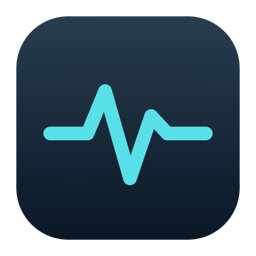
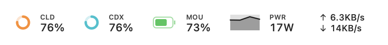
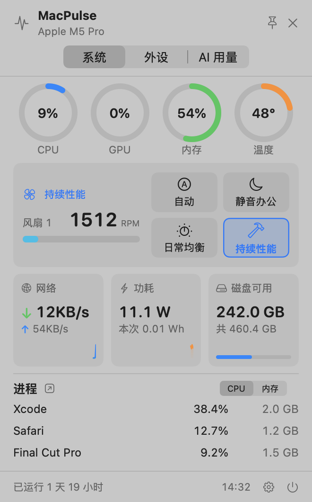
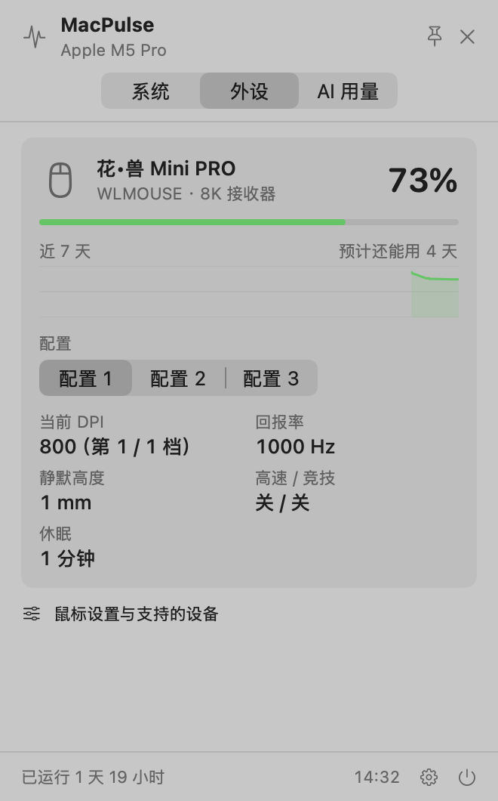
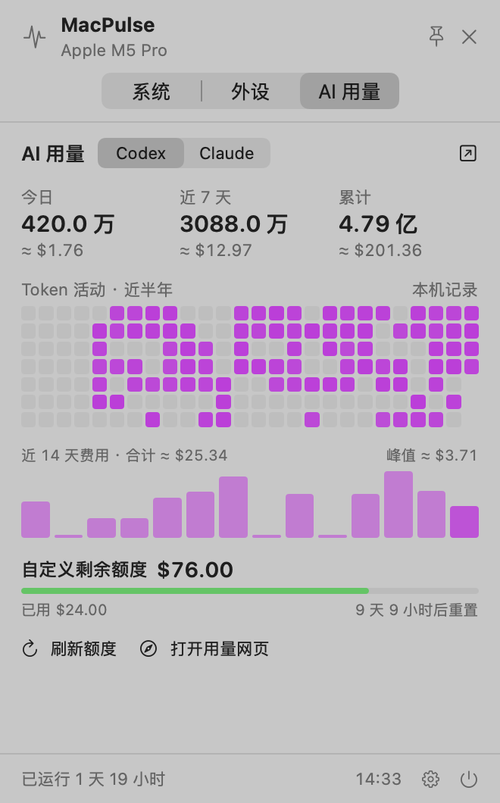
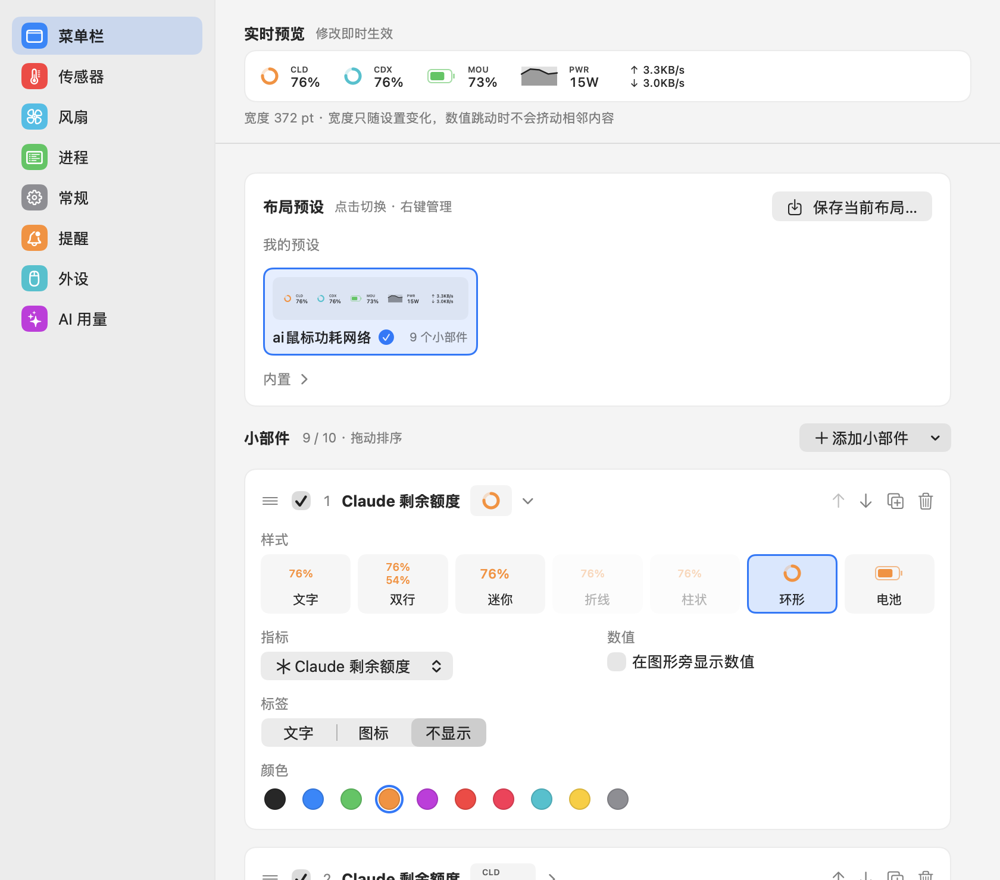
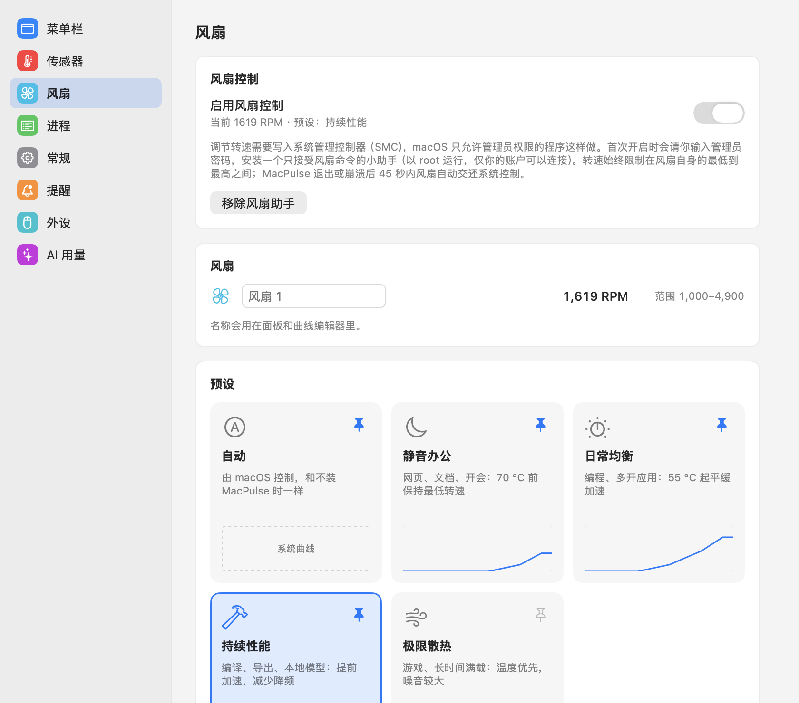

<div align="center">



# MacPulse

**Apple Silicon 原生菜单栏监控：系统、风扇、鼠标、AI 用量，一个面板看完。**

[](https://github.com/liiuuumemory/MacPulse/releases)
[](#-安装)
[](#-安装)
[](#-从源码构建)
[](#-从源码构建)
[](https://github.com/liiuuumemory/MacPulse/stargazers)

[功能](#-功能) · [截图](#-截图) · [安装](#-安装) · [隐私与安全](#-隐私与安全) · [数据口径](#-数据口径) · [开发](#-从源码构建) · [更新记录](CHANGELOG.md)

<br>

<picture>
  <source media="(prefers-color-scheme: dark)" srcset="docs/images/bar-dark.png">
  
</picture>

<br><br>

<picture>
  <source media="(prefers-color-scheme: dark)" srcset="docs/images/panel-system-dark.png">
  
</picture>
&nbsp;
<picture>
  <source media="(prefers-color-scheme: dark)" srcset="docs/images/panel-devices-dark.png">
  
</picture>
&nbsp;
<picture>
  <source media="(prefers-color-scheme: dark)" srcset="docs/images/panel-ai-dark.png">
  
</picture>

<sub>系统 · 外设 · AI 用量三页面板，跟随系统明暗模式（截图由应用内置的 <code>--snapshot</code> 离屏渲染，进程与 AI 用量为示例数据）</sub>

</div>

---

## ✨ 2.0 有什么新东西

<table>
<tr>
<td width="50%" valign="top">

### 🗂 分页面板
顶部切换“系统 / 外设 / AI 用量”，记住上次所在页。四个圆环、风扇单元、网络 / 功耗 / 磁盘卡片、Top 3 进程，一屏放下。读数都能点：CPU 跳活动监视器的 CPU 页，磁盘跳磁盘工具，温度跳传感器设置。

</td>
<td width="50%" valign="top">

### 🧩 小部件菜单栏
菜单栏由最多 10 个小部件自由拼装，每个有文字、双行、迷你、折线、柱状、环形、电池 7 种样式和 10 种颜色。布局可以存成预设（最多 20 个），右键菜单直接切换。

</td>
</tr>
<tr>
<td width="50%" valign="top">

### 🌀 风扇控制 <sup>可选</sup>
自动 + 静音办公 / 日常均衡 / 持续性能 / 极限散热四个预设，也能拖点画自己的温度曲线，多风扇机型可以每个风扇单独调。85–95 °C 安全线触发时系统自动接管。

</td>
<td width="50%" valign="top">

### 🖱 鼠标与外设
读取 WLMOUSE、罗技和蓝牙外设电量，记录近 7 天曲线并估算续航。WLMOUSE 新协议型号可直接调 DPI、回报率、静默高度、休眠时间和板载配置，写入后逐项读回校验。

</td>
</tr>
</table>

完整改动见 [CHANGELOG.md](CHANGELOG.md)。1.6 及以前的设置会自动迁移，升级后不需要重新配置。

## 🧭 功能

| | 模块 | 内容 |
|:-:|---|---|
| 📈 | **系统监控** | CPU / GPU 占用与温度、内存与交换、网络上下行、磁盘容量与读写、系统功耗（含 CPU / GPU / 神经网络引擎分项）、风扇转速、电池健康与循环次数、系统负载与开机时间 |
| 🧠 | **进程** | CPU 与内存占用最高的各 10 个进程，口径与活动监视器一致 |
| 🌡 | **传感器** | SMC 可读的全部温度 / 风扇传感器，分类双列显示，顶部附“系统概要”（点 IP 即复制） |
| 🤖 | **AI 用量** | Codex、Claude，以及有记录后自动出现的 Gemini CLI、Qwen Code、OpenCode、Grok Build；今日 / 7 天 / 累计 Token 与估算费用、近半年热力图、近 14 天费用柱状图、账户额度倒计时、服务状态 |
| 💰 | **自定义额度** | 手动台账，支持 USD / CNY / Token / 次数 / 百分比，可按日 / 周 / 月归零 |
| ☁️ | **多 Mac 汇总** | 可选，通过 iCloud 云盘合并多台 Mac 的按天用量 |
| 🔔 | **提醒** | CPU 过热、内存压力、磁盘不足、低电量、AI 额度过低，触发一次后锁存，温度有 5 °C 回差 |
| 🔄 | **检测更新** | 每天检查一次 GitHub Releases（可关闭），一键复制 `git pull && bash build.sh` |

## 📸 截图

<details open>
<summary><b>菜单栏自定义</b>：实时预览、布局预设、每个小部件的样式 / 指标 / 标签 / 颜色</summary>
<br>
<p align="center"></p>
</details>

<details>
<summary><b>风扇</b>：预设卡片、风扇命名、自定义曲线</summary>
<br>
<p align="center"></p>
</details>

## 🚀 安装

> [!NOTE]
> 需要 **Apple Silicon Mac**、**macOS 14+** 和 Xcode 命令行工具（`xcode-select --install`）。不需要 Apple 开发者账号，也没有第三方依赖。

```bash
git clone https://github.com/liiuuumemory/MacPulse.git
cd MacPulse
bash build.sh
open ~/Applications/MacPulse.app
```

应用常驻顶部菜单栏，不显示 Dock 图标。**左键**打开面板，**右键**打开设置、切换布局预设或退出，面板右上角的图钉可以把面板固定住。

<details>
<summary>更新、指定安装位置、登录时启动</summary>

- **更新**：在仓库目录运行 `git pull && bash build.sh`，再重新打开 MacPulse。设置页发现新版本时也能一键复制这条命令。
- **指定安装位置**：`bash build.sh /path/to/output`。默认装到 `~/Applications`，避免放进 iCloud 等文件同步目录。编译缓存可用 `MACPULSE_BUILD_DIR` 指定。
- **登录时启动**：应用需位于 `~/Applications` 或 `/Applications`，在“设置 → 常规”打开即可。系统要求批准时，到“系统设置 → 通用 → 登录项”。默认不开启。
- 构建产物是本地 ad-hoc 签名，未做 Apple 公证。分发给其他 Mac 时建议用 Developer ID 签名并公证。

</details>

## 🧩 菜单栏小部件

| 样式 | 适合 | | 样式 | 适合 |
|---|---|---|---|---|
| 文字 | 单个数值 | | 柱状 | CPU 每核负载 |
| 双行 | 两个相关指标，如上传 / 下载 | | 环形 | 百分比、剩余额度 |
| 迷你 | 小标签在上，数值在下 | | 电池 | 鼠标、本机电量 |
| 折线 | 功耗、网速趋势 | | | |

- 标签可选文字、图标或不显示，支持自定义文字和 26 种菜单栏图标，图标可放在左侧或右侧。
- 整体可调字号（8–13 pt）、间距、分隔线、数值宽度与对齐。
- **宽度固定**：宽度只按配置计算，不测量实时字符串。等宽数字右对齐，网速从 KB/s 跳到 MB/s 时相邻元素不会动。
- **布局预设**：保存当前布局（最多 20 个），以实时缩略图显示，点击切换、可撤销；改动后标出“有未保存的修改”。另有参考布局、简洁、性能、图表、图标 5 个内置预设。

## 🌀 风扇控制

> [!IMPORTANT]
> 风扇控制**默认关闭**。MacPulse 本身只读 SMC，开启后才经管理员密码确认安装一个 root 风扇助手，这是项目里唯一包含 SMC 写入代码的程序。

| 预设 | 场景 | 策略 |
|---|---|---|
| 🅰 自动 | 默认 | 交给 macOS，等同于没装 MacPulse |
| 🌙 静音办公 | 网页、文档、开会 | 70 °C 前保持最低转速 |
| ⏱ 日常均衡 | 编程、多开应用 | 55 °C 起平缓加速 |
| 🔨 持续性能 | 编译、导出、本地模型 | 提前加速，减少长时间负载下的降频 |
| 💨 极限散热 | 游戏、满载 | 温度优先，噪音较大 |

- **自定义曲线**：横轴 CPU 温度 30–100 °C，纵轴转速百分比并标注 RPM；拖动或双击加点，每条最多 4 个点。
- **多风扇**：可给每个风扇命名、单独调整曲线，或“复制到所有风扇”。转速按各风扇自己的最低–最高范围换算。没有风扇的 Mac（如 MacBook Air）不显示风扇相关界面。
- **面板快捷切换**：在设置里用图钉选 4 个预设或曲线放进面板，一键切换。

<details>
<summary>安全机制</summary>

- 助手路径 `/Library/PrivilegedHelperTools/local.macpulse.fanhelper`，LaunchDaemon `local.macpulse.fanhelper`。
- 只接受“查询 / 自动 / 设定转速 / 心跳”四个命令；套接字仅安装者账户可连接。
- 转速始终限制在风扇自身最低与最高之间。
- CPU 达到安全温度（85 / 90 / 95 °C）时系统临时接管，降到安全线 5 °C 以下自动恢复。
- 45 秒没有心跳或收到 SIGTERM 即交还系统控制，所以 MacPulse 退出或崩溃都不会让风扇卡在固定转速。
- 可在设置中一键移除助手。
- 写入顺序参照 [Stats](https://github.com/exelban/stats)：M5 及以后直接写模式键 `F0md`，M1–M4 需先设置 `Ftst`。
- 已在 Mac mini（M5 Pro）实测：设定 2000 RPM 后 2 秒内到位，交还自动后回到 1000 RPM。多风扇机型尚未用真机测试。

</details>

## 🖱 鼠标与外设

| 品牌 | 电量 | 设置 | 状态 |
|---|:-:|---|---|
| **WLMOUSE**（花•兽 Mini / Mini PRO / X / X PRO / MAX / X V2、幻、幻 M、影、剑 X、行者、MIAO、BEAST G） | ✅ | DPI 档位（含 X/Y 分设）、回报率、静默高度、去抖、休眠、角度微调、Motion Sync、直线修正、波纹控制、高速 / 竞技模式、板载配置与命名 | 花•兽 Mini PRO（8K 接收器）已实机验证 |
| **罗技**（HID++ 2.0） | ✅ | DPI、SmartShift、滚轮模式与方向 | ⚠️ 未经实机测试 |
| **蓝牙外设**（向系统报告 BatteryPercent 的） | ✅ | — | — |

- 修改先进草稿，点“应用到鼠标”才写入，写入后逐项读回校验。固件升级、配对、恢复出厂、按键与宏请用官方驱动。
- WLMOUSE 命令取自官方网页驱动 gm.wlmouse.gg 公开的脚本与型号表；鼠标休眠时保留上次读数并标明时间。
- 部分罗技接收器需要在“系统设置 → 隐私与安全性 → 输入监控”中允许 MacPulse；每次重新编译后 ad-hoc 签名会变，可能要重新授权。

## 🤖 AI 用量

面板的 AI 用量页显示今日、近 7 天、累计 Token 与估算费用，近半年活动热力图和近 14 天每日费用。Codex 与 Claude 始终显示，其他 agent 有记录后自动出现（超过 3 个时改为下拉菜单）。

<details>
<summary><b>数据来源</b></summary>

| 来源 | 读取内容 |
|---|---|
| CC Switch（默认优先） | 只读 `~/.cc-switch/cc-switch.db` 的 `proxy_request_logs` 与 `usage_daily_rollups`，不读服务商凭据表。能覆盖 Codex 的 `.jsonl.zst` 压缩会话，费用按其价格表和倍率计算 |
| Codex | `~/.codex/sessions` 与归档日志，按 response ID 去重，旧日志按累计值差分 |
| Claude Code | `~/.claude/projects`，按 assistant message ID 合并流式与重复记录 |
| Gemini CLI | `~/.gemini/tmp/*/chats/` 下的会话记录 |
| Qwen Code | `~/.qwen/projects/*/chats/*.jsonl` 的 usageMetadata |
| OpenCode | `~/.local/share/opencode/opencode.db` 及旧版 `storage/message/`，直接采用其记录的费用 |

某个应用在 CC Switch 中没有记录时改读它的本机日志。日志格式参考 [tokscale](https://github.com/junhoyeo/tokscale)。文件扫描每分钟一次，未变化的文件复用缓存，仍在写入的会话只读新增行。

</details>

<details>
<summary><b>费用与额度</b></summary>

- **费用估算**：按内置的 API 公开标价（2026-10），内置表没有的模型用 CC Switch 价格表；区分未缓存输入、缓存写入（5 分钟 1.25×、1 小时 2×）、缓存读取和输出。订阅套餐不按 Token 计费，金额不等于账单。
- **账户额度**：每 5 分钟查询一次。官方 Codex 用已有的 `auth.json` OAuth 登录；Sub2API 读 `/v1/usage`；Claude 用标准 Claude Code OAuth 凭据。显示“2 小时 13 分后重置”式倒计时。
- **只登录了 Claude 桌面版？** 桌面版令牌是加密保存的，MacPulse 不读。请安装命令行版 Claude Code 并登录一次，再点“连接本机 Claude Code”：

  ```bash
  curl -fsSL https://claude.ai/install.sh | bash
  ```

- 额度过期、权限不足或缺少登录时显示原因，不把未知显示为 0；保留的旧值会标记“旧数据”。
- **自定义额度**：“设置 → AI 用量”里启用，剩余 = max(0, 总额度 − 已用额度)。这是手动台账，不会按 Token 自动扣款。
- **服务状态**：随额度查询读取 status.openai.com / status.claude.com，有故障时在服务名旁提示，可关闭。

接口依据：[OpenAI Codex 账户额度](https://learn.chatgpt.com/docs/app-server) · [Claude 状态栏额度字段](https://code.claude.com/docs/en/statusline) · [Sub2API](https://github.com/Wei-Shaw/sub2api/blob/main/backend/internal/handler/gateway_handler.go) · [CodexBar 的 Claude 说明](https://github.com/steipete/CodexBar/blob/main/docs/claude.md)

</details>

## 🔒 隐私与安全

- **本机处理**：硬件采样和会话用量都在本机计算，不上传会话内容或硬件数据，不持续写日志。
- **默认只读**：不写 SMC、不装内核扩展、不装提权服务。唯一的例外是你手动开启的风扇助手。
- **网络访问**只有这几处，均不附带本机数据：
  - 账户额度：每 5 分钟访问已配置的服务商或官方账户服务
  - 服务状态页：可关闭
  - 检测更新：每天一次 api.github.com，可关闭
  - iCloud 汇总：仅开启“多台 Mac 汇总”后写入只含按天 Token 数与费用的小文件
- 登录凭据只在内存中使用，不写入本项目，也不跟随重定向。设置存在标准 UserDefaults 里。

## 📊 数据口径

无法读取的数据显示 `—`，不伪造数值。睡眠时暂停采样，唤醒后重置差分基线；网卡重连和计数器回退不会产生负数或巨大峰值。

<details>
<summary>展开每项指标的来源与含义</summary>

| 指标 | 来源与含义 |
|---|---|
| 系统功耗 | 优先读 AppleSMC `PSTR`（W）。不是插座功率，也不是 CPU 单独功耗。不可用时尝试 IORegistry 系统输入功率并标明来源 |
| 芯片分项功耗 | macOS 27 上读 AppleCLPC 的 CPU / GPU / 神经网络引擎累计能耗（nJ），按差值求平均功率。计数器 ID 参照 [macmon](https://github.com/vladkens/macmon)，仅在已知芯片启用 |
| CPU | Mach 各核心 tick 差值，0–100%，含用户 / 系统占比与各逻辑核心 |
| GPU | `IOAccelerator` 的 `Device Utilization %` |
| 温度 | AppleSMC 传感器；CPU / GPU 摘要取对应组的最高值 |
| 内存 | Mach VM 页面统计，排除可清除页面与文件缓存，包含压缩内存 |
| 进程 | `proc_pid_rusage` 的 CPU 时间差与物理占用；CPU 为占单核百分比，仅在面板或设置可见时采集 |
| 网络 | `en*` 物理接口，通过系统 netstat 读完整 64 位计数，排除 VPN、回环、AirDrop 与桥接口 |
| 磁盘 | 容量为主目录所在卷；读写为所有块存储驱动合计 |
| 电池健康 | AppleSmartBattery 标称满充容量 ÷ 设计容量，及循环次数 |
| 本次运行 Wh | 对功率采样做梯形积分，睡眠与缺失期间不计入 |
| 单位 | KB/MB/GB 按 1024 进位；菜单栏可切换为 b/s（1000 进位） |

AppleSMC 和 GPU 驱动统计不是稳定的公开 API，新机型或后续 macOS 更新可能需要适配。

</details>

## ⚡ 资源占用

| 项目 | 1.4 | 1.5+ |
|---|--:|--:|
| 单次采样（面板关闭） | ~107 ms | **~12 ms** |
| 单次采样（面板打开，含进程） | ~107 ms | **~40 ms** |
| 启动网络计数 netstat | ~74 ms | **~4.5 ms** |
| AI 日志首次扫描（177 MB Claude 日志） | 4.3 s / ~200 MB | **0.66 s / ~28 MB** |

<sub>M2 Pro 实测。面板和设置都关闭时不触发 SwiftUI 刷新，菜单栏只在内容变化时重绘，屏幕休眠时采样降到 5 秒一次。</sub>

## 🛠 从源码构建

纯 Swift + 少量 C，无第三方依赖。用到 SwiftUI、AppKit、Mach、IOKit、IOReport、UserNotifications 和 ServiceManagement。`build.sh` 直接调用 `clang` / `swiftc` 编译 arm64，做 ad-hoc 签名并验证，不需要 Xcode 工程。

<details>
<summary><b>命令行参数</b></summary>

```bash
APP="$HOME/Applications/MacPulse.app/Contents/MacOS/MacPulse"
"$APP" --test       # 内置自检，不修改真实设置
"$APP" --diagnose   # 采集真实硬件数据，输出 JSON
```

| 参数 | 作用 |
|---|---|
| `--test` | 固定宽度布局、配置序列化、网络计数、功耗积分、AI 用量去重与费用、提醒逻辑、额度解析等自检 |
| `--diagnose` | 输出采样耗时、分项功耗、电池健康、传感器与风扇等真实读数（JSON，不需要 sudo） |
| `--quota-check claude\|codex` | 测试账户额度能否读取 |
| `--snapshot <path.png>` | 离屏渲染总览面板 |
| `--panel-page system\|devices\|ai` | 配合 `--snapshot` 选择面板页 |
| `--snapshot-tab <tab>` | 渲染设置页：`menu` / `sensors` / `fan` / `processes` / `alerts` / `ai` / `settings`，或 `bar` 渲染菜单栏 |
| `--dark` / `--compact` | 深色模式 / 480 pt 紧凑面板 |
| `--snapshot-custom` / `--snapshot-demo` | 用示例额度、预设、风扇曲线 / 示例进程与 AI 用量渲染，截图不含本机真实数据 |
| `--snapshot-hover` | 渲染所有可点击读数的悬停高亮 |
| `--simulate-fans N` | 用 0–3 个模拟风扇渲染，检查无风扇和多风扇布局 |
| `--settings` | 直接打开设置窗口 |
| `--mouse-dump` / `--mouse-roundtrip` | 调试鼠标通信 |

截图与自检进程不会控制风扇、不保存设置。

</details>

<details>
<summary><b>项目结构</b></summary>

```
Source/
├── main.swift            菜单栏、弹出面板、自检与渲染入口
├── Monitor.swift         后台采样、历史数据、设置、睡眠恢复
├── Metrics.swift         CPU / 内存 / 网络 / 磁盘 / GPU / 功耗 / 传感器采集
├── Sensors.c / .h        只读 SMC、64 位网络计数、netstat、AppleCLPC 能耗
├── Panel.swift           330 pt 毛玻璃面板（系统 / 外设 / AI 用量）
├── MenuBar.swift         小部件配置、固定宽度布局、菜单栏编辑器
├── Preferences.swift     设置窗口、传感器与常规设置
├── SystemJump.swift      读数点击跳转（活动监视器、磁盘工具、系统设置）
├── Alerts.swift          提醒规则与系统通知
├── Updater.swift         GitHub Releases 检测更新
├── FanControl.swift      风扇预设与曲线、助手安装卸载、安全回退
├── FanHelper/main.swift  可选的 root 风扇助手（唯一包含 SMC 写入）
├── Peripherals.swift     无线外设电量
├── WLMouse.swift         WLMOUSE 型号表与读写命令
├── Logitech.swift        罗技 HID++ 2.0
├── MouseSettings.swift   “外设”设置页与读写调度
├── AIUsage.swift         Token 统计、增量续读、费用估算、CC Switch、自定义额度
├── AgentLogs.swift       Gemini CLI / Qwen Code / OpenCode 日志
├── QuotaClient.swift     账户额度查询（Codex、Claude OAuth、Sub2API）
├── AIUsageViews.swift    服务切换、热力图、额度界面
├── AIUsageTests.swift    独立样本测试
└── UsageSync.swift       iCloud 多设备汇总
```

</details>

## 🗑 卸载

1. 如果开过风扇控制，先在“设置 → 风扇”点 **移除风扇助手**。
2. 在“设置 → 常规”关闭登录时启动。
3. 右键菜单栏图标退出，删除 `~/Applications/MacPulse.app`。

## 🙏 致谢

- [Stats](https://github.com/exelban/stats)：传感器键名与风扇写入顺序参考（MIT）
- [macmon](https://github.com/vladkens/macmon)：AppleCLPC 计数器 ID 与通道格式（MIT，© 2024 vladkens）
- [OpenLogi](https://github.com/AprilNEA/OpenLogi)：罗技 HID++ 报文格式与功能编号（MIT / Apache-2.0）
- [tokscale](https://github.com/junhoyeo/tokscale)：各 agent 日志格式整理
- [CodexBar](https://github.com/steipete/CodexBar)：Claude OAuth 额度查询方式

以上项目的代码均未直接引入，MacPulse 的采集器与界面以 Swift 独立实现。

<div align="center">
<br>
<sub>如果 MacPulse 对你有用，欢迎点个 ⭐</sub>
</div>
