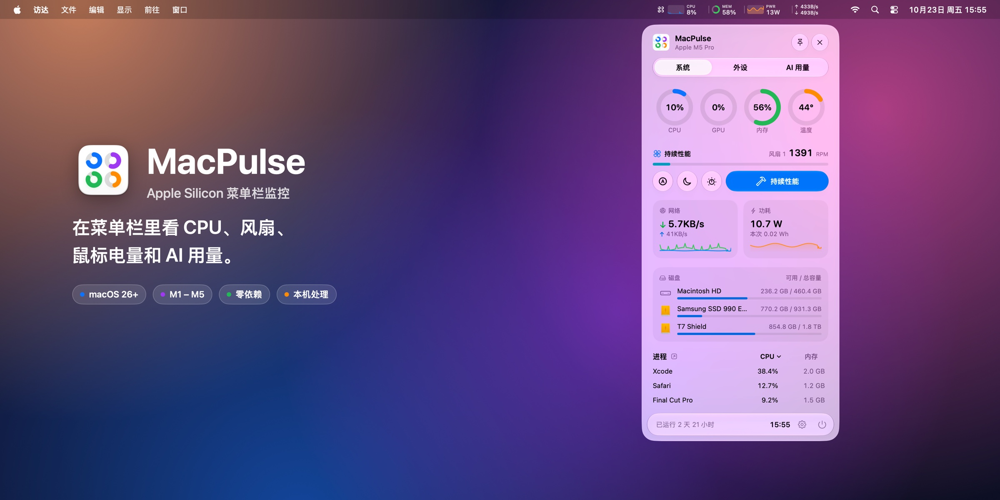
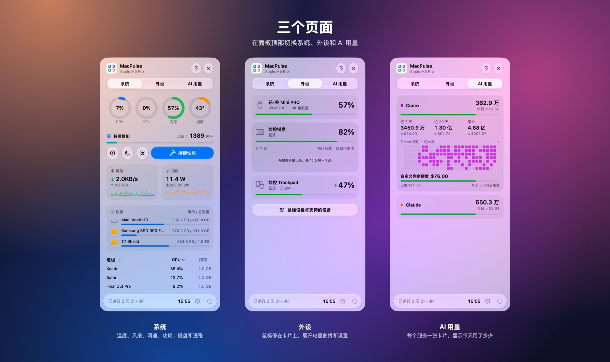
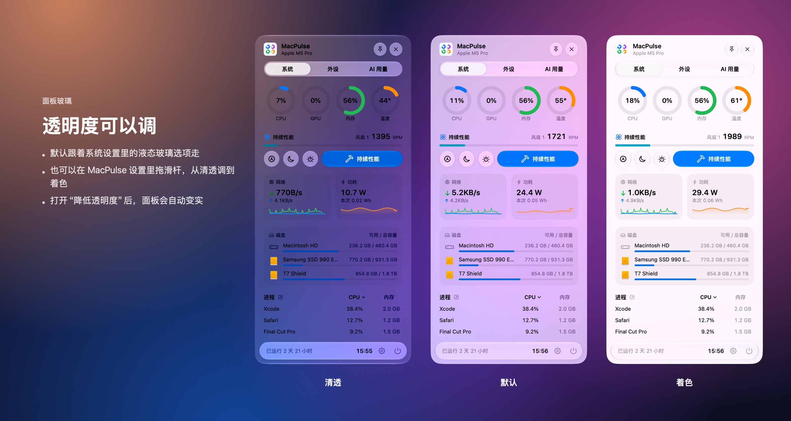
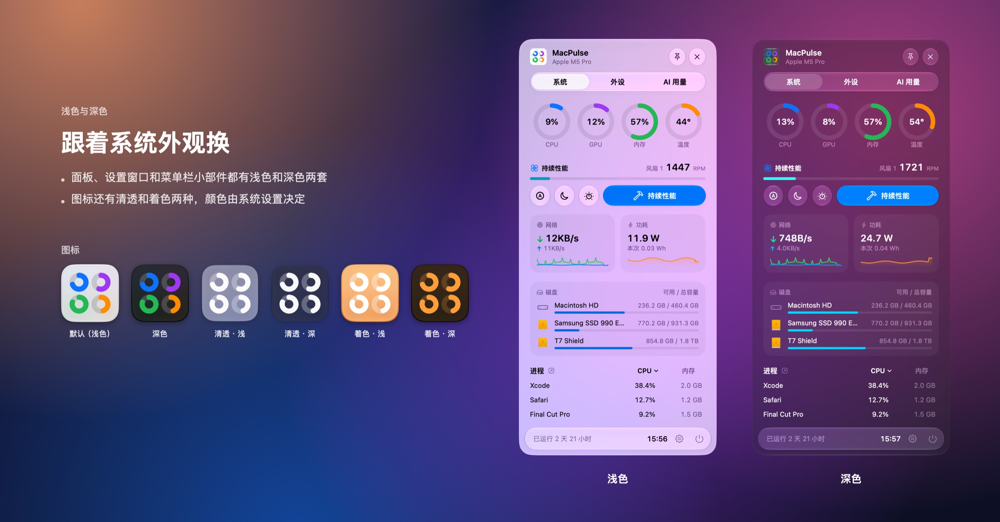
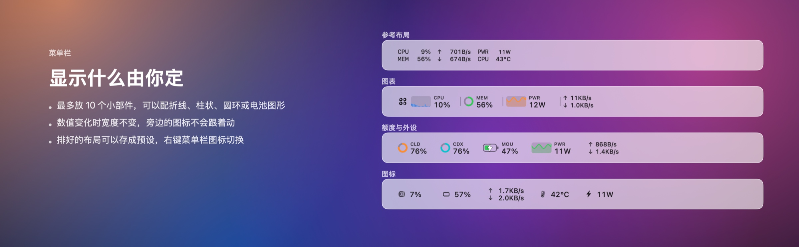
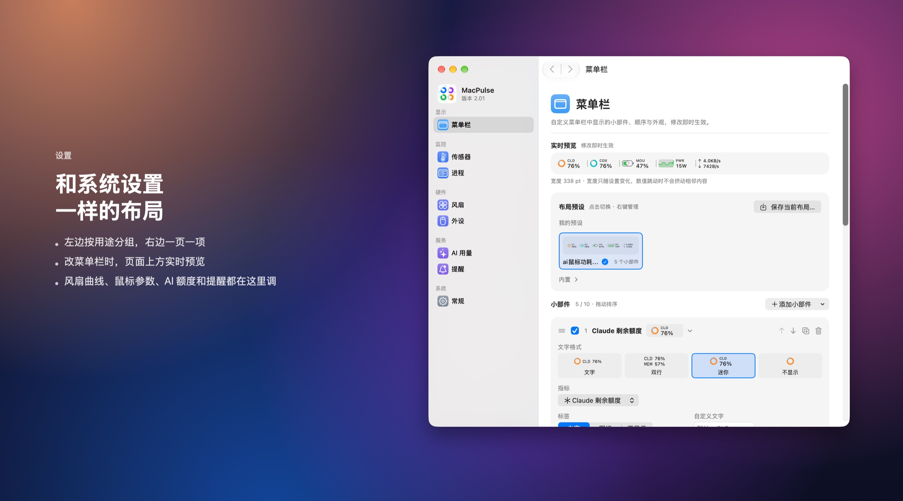

<div align="center">



<br>

[](https://github.com/liiuuumemory/MacPulse/releases)
[](#安装)
[](#安装)
[](#从源码构建)
[](#从源码构建)

**[一览](#一览)** &nbsp;·&nbsp; **[玻璃与深浅色](#面板玻璃)** &nbsp;·&nbsp; **[菜单栏](#菜单栏)** &nbsp;·&nbsp; **[安装](#安装)** &nbsp;·&nbsp; **[功能](#功能)** &nbsp;·&nbsp; **[隐私](#隐私与安全)** &nbsp;·&nbsp; **[开发](#从源码构建)** &nbsp;·&nbsp; **[更新记录](CHANGELOG.md)**

</div>

<br>

## 一览



点菜单栏里的 MacPulse，面板会从图标下方展开。顶部的分页用来切换系统、外设和 AI 用量三页，内容滚动时会从顶栏和底栏下面透出来。点面板外面、切到别的应用或按 Esc 就会关闭；想让它一直开着，点右上角的图钉。

<table>
<tr>
<td width="33%" valign="top">

**系统**

最上面是 CPU、GPU、内存和温度四个圆环，下面是风扇预设、网络和功耗曲线、最多三个磁盘（外接盘也算），最后是占用最高的三个进程，点列标题可以换排序。大部分读数都能点，会打开活动监视器、磁盘工具或对应的设置页。

</td>
<td width="33%" valign="top">

**外设**

每个外设一张卡片，平时只显示电量或连接方式。鼠标停在卡片上，它会展开显示近 7 天的电量曲线和预计续航；WLMOUSE 鼠标还能在这里切换板载配置，改 DPI 和回报率；VIA 键盘可以开关灯光，调亮度和效果。

</td>
<td width="33%" valign="top">

**AI 用量**

Codex、Claude 和其他有记录的 agent 各占一张卡片，显示今天的 Token、费用和剩余额度。展开后能看到近 7 天、近 30 天、累计用量和半年热力图，点数值会进入设置里的完整用量页。

</td>
</tr>
</table>

## 面板玻璃



面板、分页和按钮用的是 macOS 26 自带的液态玻璃。“设置 → 常规 → 面板玻璃”里有两个选项。选“跟随系统”时，面板和系统设置里的液态玻璃透明度保持一致；选“自定义”会出现一个从清透到着色的滑杆，旁边有实时预览，把面板固定住也能边调边看。打开“降低透明度”或“增加对比度”后，系统会自动把面板变实。



面板、设置窗口和菜单栏小部件都会跟着系统切换浅色和深色。玻璃在浅色下稍微提亮，在深色下稍微压暗，换了花哨的壁纸文字也能看清。应用图标是四个圆环，在系统设置里可以换成深色、清透或着色外观。

## 菜单栏



菜单栏最多放 10 个小部件。每个小部件先选文字格式，再决定左边要不要加一个图形：

| 文字格式 | 适合 | 图形（可选） | 适合 |
|---|---|---|---|
| 文字 | 单个数值 | 折线 | 功耗、网速趋势 |
| 双行 | 两个相关指标，如上传 / 下载（不能加图形） | 柱状 | CPU 每核负载 |
| 迷你 | 小标签在上，数值在下 | 环形 | 百分比、剩余额度 |
| 不显示 | 只要图形 | 电池 | 鼠标、本机电量 |

每个小部件的宽度只由配置决定，数字等宽并右对齐，所以网速从 KB/s 跳到 MB/s 时，旁边的图标位置不变。颜色只用在进度弧、柱子和折线上，数字和标签跟着菜单栏的明暗走。

排好的布局可以存成预设，最多 20 个，另外自带 6 个。右键菜单栏图标就能切换，菜单里显示的是每个预设的实时缩略图。菜单栏图标有 27 种可选（包括 MacPulse 的四环图标），可以放在左边或右边。

## 设置



设置窗口照着系统设置的样子做：左边是侧栏，分显示、监控、硬件、服务、系统五组，包括菜单栏编辑器、传感器、进程、风扇、外设、AI 用量、提醒和常规。顶栏有后退和前进（⌘[ / ⌘]），从面板点进来的页面也会记进历史。

## 安装

> [!NOTE]
> 需要 Apple Silicon Mac、macOS 26 或更新，以及 Xcode 命令行工具（`xcode-select --install`）。不需要 Apple 开发者账号，也没有第三方依赖。

```bash
git clone https://github.com/liiuuumemory/MacPulse.git
cd MacPulse
bash build.sh
open ~/Applications/MacPulse.app
```

MacPulse 只在菜单栏显示，没有 Dock 图标。左键打开面板，右键打开设置、切换布局预设或退出。

<details>
<summary><b>更新、安装位置、登录时启动</b></summary>
<br>

更新时在仓库目录运行 `git pull && bash build.sh`，然后重新打开 MacPulse。设置里提示有新版本时，也可以直接复制这条命令。

默认装到 `~/Applications`。想换位置就运行 `bash build.sh /path/to/output`，但别放进 iCloud 这类同步目录；编译缓存的位置可以用 `MACPULSE_BUILD_DIR` 指定。

登录时启动默认关闭，在“设置 → 常规”里打开，前提是应用放在 `~/Applications` 或 `/Applications`。如果系统要求批准，到“系统设置 → 通用 → 登录项”里允许。

构建出来的应用只有本地 ad-hoc 签名，没有经过 Apple 公证。要分发给其他 Mac，最好用 Developer ID 签名并公证。

</details>

<details>
<summary><b>卸载</b></summary>
<br>

1. 如果开过风扇控制，先在“设置 → 风扇”里点“移除风扇助手”。
2. 在“设置 → 常规”关闭登录时启动。
3. 右键菜单栏图标退出，删除 `~/Applications/MacPulse.app`。

</details>

## 功能

系统监控覆盖 CPU 和 GPU 的占用与温度、内存与交换、网络上下行、磁盘容量与读写、系统功耗（含 CPU、GPU、神经网络引擎分项）、风扇转速、电池健康与循环次数、系统负载和开机时间。进程列表按 CPU 和内存占用排序，算法和活动监视器一致。传感器页列出 SMC 能读到的所有温度和风扇传感器，顶部有一段系统概要，点 IP 就能复制。

磁盘会列出本机磁盘和外接盘，面板上最多显示三个，在“设置 → 常规 → 面板中的磁盘”里挑。本机磁盘用这台 Mac 的图标，外接盘用访达里的图标，磁盘映像和网络盘不列出。

提醒包括 CPU 过热、内存压力、磁盘不足、电量低和 AI 额度低。同一条提醒触发后不会反复弹，温度要回落 5 °C 才重新计。

另外还有几项可选功能：通过 iCloud 云盘把几台 Mac 的每日 AI 用量合在一起；每天查一次 GitHub Releases 看有没有新版本（可以关掉）。风扇控制、鼠标与键盘、AI 用量分别在下面细说。

### 风扇控制

> [!IMPORTANT]
> 风扇控制默认关闭。MacPulse 本身只读 SMC，开启风扇控制时会请你输入管理员密码，安装一个 root 权限的风扇助手。整个项目里只有这个助手会写 SMC。

| 预设 | 场景 | 策略 |
|---|---|---|
| 自动 | 默认 | 交给 macOS，和没装 MacPulse 一样 |
| 静音办公 | 网页、文档、开会 | 70 °C 以前保持最低转速 |
| 日常均衡 | 编程、多开应用 | 55 °C 开始缓慢加速 |
| 持续性能 | 编译、导出、本地模型 | 提前加速，长时间负载下少降频 |
| 极限散热 | 游戏、满载 | 优先压温度，噪音较大 |

自定义曲线的横轴是 CPU 温度（30–100 °C），纵轴是转速百分比，拖动或双击可以加点，每条最多 4 个点。有多个风扇时，可以给每个风扇起名、单独调曲线，也可以一键复制到所有风扇；没有风扇的 Mac 不会显示这些界面。面板上放哪 4 个预设或曲线，在设置里用图钉选。

<details>
<summary><b>安全机制</b></summary>
<br>

- 助手装在 `/Library/PrivilegedHelperTools/local.macpulse.fanhelper`，LaunchDaemon 名为 `local.macpulse.fanhelper`。
- 助手只认查询、自动、设定转速和心跳四个命令，套接字只有安装它的账户能连。
- 转速始终限制在风扇自己的最低和最高转速之间。
- CPU 到达安全温度（85 / 90 / 95 °C）时交回系统控制，降到安全线 5 °C 以下再恢复。
- 45 秒收不到心跳或收到 SIGTERM，助手就把风扇交还给系统，所以 MacPulse 退出或崩溃都不会让风扇停在固定转速。
- 写入顺序参考了 [Stats](https://github.com/exelban/stats)：M5 及以后直接写模式键 `F0md`，M1 到 M4 要先设置 `Ftst`。
- 在 Mac mini（M5 Pro）上实测过，多风扇机型还没有真机测试。

</details>

### 鼠标与键盘

“设置 → 外设”先列出所有鼠标和键盘，每台一张卡片；能调的设备点“自定义”进入自己的页面。

| 设备 | 电量 | 设置 | 状态 |
|---|:-:|---|---|
| WLMOUSE（花•兽 Mini / Mini PRO / X / X PRO / MAX / X V2、幻、幻 M、影、剑 X、行者、MIAO、BEAST G） | ✓ | DPI 档位（可分设 X/Y）、回报率、静默高度、去抖、休眠、角度微调、Motion Sync、直线修正、波纹控制、高速 / 竞技模式、板载配置与命名 | 花•兽 Mini PRO（8K 接收器）实机验证过 |
| 罗技（HID++ 2.0） | ✓ | DPI、SmartShift、滚轮模式与方向 | 没有实机测试 |
| VIA 键盘：BUFF67v3r2、Binepad BNK16（有线） | — | 多层改键、旋钮、宏、灯光 | 两把都实机验证过读写 |
| 会向系统报告电量的蓝牙外设 | ✓ | — | — |
| 其他 USB 键盘 | — | — | 只显示连接状态 |

WLMOUSE 每秒读一次电量和充电状态，屏幕休眠时改成 5 分钟一次，插拔接收器或充电线时会马上读。改设置时先存草稿，点“应用到鼠标”才写进去，写完逐项读回来核对。鼠标的固件升级、配对、按键和宏还是要用官方驱动。

键盘页按 VIA 定义画出键盘的实际形状，键帽显示所选层的真实键位。点一个键会弹出选键浮层，可以按分类挑、搜索，或者直接按 Mac 键盘上的键录入；组合键、按住修饰 / 点按、按住切层 / 点按也能在这里拼。旋钮按层分别设逆时针、顺时针和按下。宏按步骤编辑（输入文字、点按、按下、松开、等待），文字只能是英文字母、数字和符号。灯光拖动时实时变化，点“应用到键盘”才保存。

协议说明、型号表、键码表、原始 VIA 定义和实测数据都整理在 [docs/drivers](docs/drivers/README.md)，方便移植到其他平台。

键盘的修改和鼠标一样先存草稿，写入时只发送改过的部分，写完把整把键盘读回来核对。每次启动后第一次写入某把键盘前，会自动备份整套键位、旋钮、宏和灯光到 `~/Library/Application Support/MacPulse/Keyboards/`，在“备份”菜单里可以恢复。MacPulse 不发送进刷机模式、清空 EEPROM、重置键位或宏的命令，刷固件请用官方配置器。VIA 网页或官方配置器开着时，不要同时在 MacPulse 里修改。

部分罗技接收器需要在“系统设置 → 隐私与安全性 → 输入监控”里允许 MacPulse，重新编译后可能要再授权一次。

### AI 用量

<details>
<summary><b>数据来源</b></summary>
<br>

| 来源 | 读取内容 |
|---|---|
| CC Switch（默认优先） | 只读 `~/.cc-switch/cc-switch.db` 的 `proxy_request_logs` 与 `usage_daily_rollups`，不读服务商凭据表 |
| Codex | `~/.codex/sessions` 与归档日志，按 response ID 去重 |
| Claude Code | `~/.claude/projects`，按 assistant message ID 合并流式与重复记录 |
| Gemini CLI | `~/.gemini/tmp/*/chats/` 下的会话记录 |
| Qwen Code | `~/.qwen/projects/*/chats/*.jsonl` 的 usageMetadata |
| OpenCode | `~/.local/share/opencode/opencode.db` 及旧版 `storage/message/`，直接采用其记录的费用 |

某个应用在 CC Switch 里没有记录时，就去读它在本机的日志，日志格式参考了 [tokscale](https://github.com/junhoyeo/tokscale)。日志每分钟扫一次，没变的文件直接用缓存，还在写的会话只读新增的行。

</details>

<details>
<summary><b>费用与额度</b></summary>
<br>

费用按内置的 API 公开价格（2026-10）估算，未缓存输入、缓存写入（5 分钟 1.25 倍，1 小时 2 倍）、缓存读取和输出分开算。订阅套餐不按 Token 收费，所以这个数字和账单对不上。

账户额度每 5 分钟查一次。官方 Codex 用本机已有的 `auth.json` 登录，Sub2API 读 `/v1/usage`，Claude 用 Claude Code 标准的 OAuth 凭据。如果你只登录了 Claude 桌面版：桌面版的令牌是加密存放的，MacPulse 不去读。装一个命令行版 Claude Code 并登录一次，再点“连接本机 Claude Code”就行：

```bash
curl -fsSL https://claude.ai/install.sh | bash
```

额度过期、权限不够或没登录时，界面会写明原因，读不到的额度不会显示成 0。

自定义额度在“设置 → AI 用量”里打开，单位可以是 USD、CNY、Token、次数或百分比，可以按日、周或月归零。它只是手动记账，不会按 Token 自动扣。

查额度时顺便读取 status.openai.com 和 status.claude.com，服务出故障会在名字旁边提示，这个也能关。

接口依据：[OpenAI Codex 账户额度](https://learn.chatgpt.com/docs/app-server) · [Claude 状态栏额度字段](https://code.claude.com/docs/en/statusline) · [Sub2API](https://github.com/Wei-Shaw/sub2api/blob/main/backend/internal/handler/gateway_handler.go) · [CodexBar 的 Claude 说明](https://github.com/steipete/CodexBar/blob/main/docs/claude.md)

</details>

## 隐私与安全

硬件数据和 AI 会话用量都在本机计算，会话内容和硬件数据不会上传，也不会一直写日志。MacPulse 默认只读，不写 SMC，不装内核扩展或提权服务；唯一的例外是你自己打开的风扇助手。鼠标和键盘只在你点“应用”时写入，识别键盘只读设备属性，不打开键盘，也不读取按键。

会联网的只有下面几处，请求里都不带本机数据：

- 查账户额度，每 5 分钟访问一次你配置的服务商或官方账户服务
- 读服务状态页，可以关掉
- 检测更新，每天访问一次 api.github.com，可以关掉
- 打开“多台 Mac 汇总”后，往 iCloud 云盘写一个只有每日 Token 数和费用的小文件

登录凭据只在内存里用，不写进本项目，请求也不跟随重定向。设置保存在标准的 UserDefaults 里。

## 数据口径

读不到的数据显示为 `—`。Mac 睡眠时停止采样，醒来后重新取差分基线，所以网卡重连或计数器回退时不会出现负数或突然的尖峰。

<details>
<summary><b>每项指标的来源与含义</b></summary>
<br>

| 指标 | 来源与含义 |
|---|---|
| 系统功耗 | 优先读 AppleSMC `PSTR`（W）。不是插座功率，也不是 CPU 单独功耗 |
| 芯片分项功耗 | 读 AppleCLPC 的 CPU / GPU / 神经网络引擎累计能耗，按差值求平均功率。计数器 ID 参照 [macmon](https://github.com/vladkens/macmon) |
| CPU | Mach 各核心 tick 差值，0–100%，含用户 / 系统占比与各逻辑核心 |
| GPU | `IOAccelerator` 的 `Device Utilization %` |
| 温度 | AppleSMC 传感器；CPU / GPU 摘要取对应组的最高值 |
| 内存 | Mach VM 页面统计，排除可清除页面与文件缓存，包含压缩内存 |
| 进程 | `proc_pid_rusage` 的 CPU 时间差与物理占用；CPU 为占单核百分比，只在面板或设置里的进程页打开时采集 |
| 网络 | `en*` 物理接口的字节计数，排除 VPN、回环、AirDrop 与桥接口。系统给普通应用的计数是 32 位、以 1 KB 为单位，MacPulse 按回绕计算差值，接口重新连接的那一秒记为 0 |
| 磁盘 | 面板列出本机与外接的本地卷（每 10 秒刷新一次列表）；读写速度为所有块存储驱动合计 |
| 电池健康 | AppleSmartBattery 标称满充容量 ÷ 设计容量，及循环次数 |
| 本次运行 Wh | 对功率采样做梯形积分，睡眠与缺失期间不计入 |
| 单位 | KB / MB / GB 按 1024 进位；菜单栏可切换为 b/s（1000 进位） |

AppleSMC 和 GPU 驱动的统计都不是稳定的公开 API，新机型或以后的 macOS 更新可能要重新适配。

</details>

## 资源占用

| 场景 | 每次采样耗时 |
|---|--:|
| 只有菜单栏 | 约 2 ms |
| 面板打开（含进程） | 约 18 ms |
| 设置里的传感器页（读取全部传感器） | 约 30 ms |
| AI 日志首次扫描（177 MB Claude 日志） | 0.66 s |

只有菜单栏在跑时，MacPulse 平均占单核 CPU 的 1% 左右，大部分花在每秒重画菜单栏上，内存约 40 MB。打开面板时内存会涨到 130 MB 左右，关掉一分钟后面板内容整个释放，回到 40 MB 上下；设置窗口关掉就释放。

<sub>在 Mac mini（M5 Pro）上测的。面板和设置都关着时不刷新界面，菜单栏只在内容变了才重绘，屏幕休眠时改成 5 秒采样一次。</sub>

## 从源码构建

代码是 Swift 加少量 C，没有第三方依赖，用到了 SwiftUI、AppKit、Mach、IOKit、IOReport、DiskArbitration、UserNotifications 和 ServiceManagement。`build.sh` 直接调用 `clang` 和 `swiftc` 编译 arm64，然后做 ad-hoc 签名和校验，不需要 Xcode 工程。

<details>
<summary><b>命令行参数</b></summary>
<br>

```bash
APP="$HOME/Applications/MacPulse.app/Contents/MacOS/MacPulse"
"$APP" --test       # 内置自检，不修改真实设置
"$APP" --diagnose   # 采集真实硬件数据，输出 JSON
```

| 参数 | 作用 |
|---|---|
| `--test` | 固定宽度布局、配置序列化、网络计数、功耗积分、AI 用量去重与费用、提醒逻辑、额度解析等自检 |
| `--diagnose` | 输出采样耗时、分项功耗、电池健康、传感器与风扇等真实读数（JSON，不需要 sudo） |
| `--quota-check claude\|codex` | 测试账户额度能否读取 |
| `--settings` | 直接打开设置窗口 |
| `--mouse-dump` / `--mouse-roundtrip` | 调试鼠标通信 |
| `--keyboard-dump [--raw]` | 只读导出每把 VIA 键盘的键位、旋钮、宏和灯光，`--raw` 加原始键码 |
| `--keyboard-roundtrip [名称]` | 键盘写入回环：先备份，改一个键、一个旋钮、最后一个宏槽和亮度，核对后写回原值再核对 |
| `--keyboard-preview` | 用记录下来的两把键盘数据显示界面，不碰设备 |
| `--export-driver-data <目录>` | 把键盘、鼠标型号表和键码表导出成 JSON，见 [docs/drivers](docs/drivers/README.md) |

截图用的参数如下。截图和自检时不会控制风扇，也不会保存设置。

| 参数 | 作用 |
|---|---|
| `--snapshot <path.png>` | 离屏渲染面板，只用来检查布局 |
| `--onscreen` | 把真实的玻璃面板或设置窗口显示在屏幕上，成为当前窗口后打印窗口号，用 `screencapture -o -l <窗口号>` 截取 |
| `--panel-page system\|devices\|ai` | 选择面板页 |
| `--snapshot-tab <tab>` | 渲染设置页：`menu` / `sensors` / `fan` / `processes` / `alerts` / `ai` / `mouse` / `settings`，设备页 `device:<设备>`（如 `device:kbd-usb-1a86-fc16-00123000`），`keypicker` / `knobpicker` 单独渲染选键浮层，或 `bar` 渲染菜单栏 |
| `--keyboard-tab keymap\|macros\|lighting` / `--keyboard-layer N` | 键盘页的标签和层 |
| `--keyboard-select r,c\|knobN` / `--keyboard-macro N` | 选中一个键或旋钮 / 展开一个宏 |
| `--snapshot-demo` / `--snapshot-custom` | 示例进程、AI 用量、外设与曲线 / 示例额度、预设、风扇曲线，截图不含本机真实数据 |
| `--snapshot-open` / `--snapshot-card <id>` | 展开外设页、AI 用量页的第一张卡片 / 指定的卡片（如 `kbd-usb-…`） |
| `--snapshot-backdrop` | 在面板后面垫固定的示例背景 |
| `--snapshot-at x,y` | 把面板放在屏幕上指定位置（宣传图合成用） |
| `--snapshot-glass system\|0–1` | 面板玻璃用“跟随系统”或指定着色程度 |
| `--snapshot-scroll <pt>` / `--panel-height <pt>` | 页面滚动到指定位置 / 指定面板高度 |
| `--snapshot-transparent` | 菜单栏截图不画背景 |
| `--dark` / `--compact` / `--simulate-fans N` | 深色模式 / 480 pt 紧凑面板 / 用 0–3 个模拟风扇 |

</details>

<details>
<summary><b>项目结构</b></summary>
<br>

```
Source/
├── main.swift            菜单栏、面板显示与关闭、自检与截图入口
├── Monitor.swift         后台采样、历史数据、设置、睡眠恢复
├── Metrics.swift         CPU / 内存 / 网络 / 磁盘 / GPU / 功耗 / 传感器采集
├── Sensors.c / .h        只读 SMC、AppleCLPC 能耗
├── Panel.swift           356 × 750 pt 液态玻璃面板（系统 / 外设 / AI 用量）、四环 logo
├── PanelControls.swift   玻璃分页、可排序列标题、居中滚动、悬停展开卡片
├── GlassPanel.swift      面板窗口：无边框透明窗口，挂在菜单栏图标下方，自绘圆角阴影
├── MenuBar.swift         小部件配置、固定宽度布局、菜单栏编辑器
├── Preferences.swift     设置窗口、传感器与常规设置、面板磁盘与玻璃
├── SystemJump.swift      读数点击跳转（活动监视器、磁盘工具、系统设置）
├── Alerts.swift          提醒规则与系统通知
├── Updater.swift         GitHub Releases 检测更新
├── FanControl.swift      风扇预设与曲线、助手安装卸载、安全回退
├── FanHelper/main.swift  可选的 root 风扇助手（唯一包含 SMC 写入）
├── Peripherals.swift     无线外设电量
├── WLMouse.swift         WLMOUSE 型号表与读写命令
├── Logitech.swift        罗技 HID++ 2.0
├── MouseSettings.swift   鼠标设备页与读写调度
├── Keyboard.swift        VIA 键盘型号表、键码名称、宏编码、KeyboardCenter
├── VIAKeyboard.swift     VIA 收发与读写、USB 键盘识别、键盘备份
├── KeyboardSettings.swift “外设”总览、设备二级页、键盘绘制、选键、宏、灯光、面板键盘卡片
├── AIUsage.swift         Token 统计、增量续读、费用估算、CC Switch、自定义额度
├── AgentLogs.swift       Gemini CLI / Qwen Code / OpenCode 日志
├── QuotaClient.swift     账户额度查询（Codex、Claude OAuth、Sub2API）
├── AIUsageViews.swift    面板 AI 用量卡片、热力图、额度界面
├── AIUsageTests.swift    独立样本测试
└── UsageSync.swift       iCloud 多设备汇总
```

</details>

## 致谢

- [Stats](https://github.com/exelban/stats)：传感器键名与风扇写入顺序（MIT）
- [macmon](https://github.com/vladkens/macmon)：AppleCLPC 计数器 ID 与通道格式（MIT，© 2024 vladkens）
- [OpenLogi](https://github.com/AprilNEA/OpenLogi)：罗技 HID++ 报文格式与功能编号（MIT / Apache-2.0）
- [tokscale](https://github.com/junhoyeo/tokscale)：各 agent 的日志格式
- [CodexBar](https://github.com/steipete/CodexBar)：Claude OAuth 额度的查询方式

这些项目的代码都没有直接拿来用，MacPulse 的采集和界面是用 Swift 另外写的。

<br>

<div align="center">

<br>
<sub>觉得好用的话，点个 Star 吧</sub>
</div>
